# VOXHAND: Technical Architecture & Code Reference (Judge / Evaluator Guide)

This document explains the end-to-end computer vision, mathematical normalization, gesture classification, temporal debouncing, and speech synthesis algorithms implemented in **VOXHAND**.

For a single self-contained code file of the core algorithm, see [`VOXHAND_CORE_ALGORITHM.ts`](./VOXHAND_CORE_ALGORITHM.ts).

---

## 1. End-to-End System Pipeline

```mermaid
flowchart LR
    CAM["Webcam / Kinematic SimBench<br/>(30–60 FPS)"] --> MP["MediaPipe Hands<br/>(21 3D Landmarks x,y,z)"]
    MP --> NORM["3D Normalization<br/>(Wrist Origin + Palm Span + Roll Alignment)"]
    NORM --> FEAT["83-D Feature Extraction<br/>(Joint Angles + Reach + Curl Ratios)"]
    FEAT --> CLF["Hybrid Classifier<br/>(Biomechanical Rules + Cosine Similarity)"]
    CLF --> DEB["Temporal Stabilizer<br/>(5-Frame Majority + 600ms Hold Latch)"]
    DEB --> BUF["Sentence Buffer<br/>(20 Mandatory Word Signs)"]
    BUF -->|User Presses 'Read Full Sentence'| TTS["Web Speech Synthesis API<br/>(Volume, Speed, Pitch, Voice)"]
```

---

## 2. Mathematical Formulation (How Hand Tracking Works)

### Step A: Translation & Camera-Distance Normalization
MediaPipe Hands outputs 21 3D landmarks $P_i = (x_i, y_i, z_i)$ for $i \in \{0, \dots, 20\}$, where $P_0$ is the **Wrist** and $P_9$ is the **Middle Finger MCP (knuckle)**.

To make recognition invariant to where the hand is in the camera frame and how close/far it is from the webcam, we compute the **Palm Span**:

$$S_{\text{palm}} = \| P_9 - P_0 \|_2 = \sqrt{(x_9 - x_0)^2 + (y_9 - y_0)^2 + (z_9 - z_0)^2}$$

Every landmark is centered on the wrist and scaled by $S_{\text{palm}}$:

$$\hat{P}_i = \frac{P_i - P_0}{S_{\text{palm}}}$$

### Step B: In-Plane Roll Rotation Invariance
If a user tilts their hand in front of the camera, raw coordinates shift. VOXHAND computes the in-plane angle $\theta$ of the Wrist-to-Middle-MCP vector $\hat{P}_9$ and rotates all 21 points so the palm axis is aligned vertically ($-90^\circ$):

$$\Delta\theta = -\frac{\pi}{2} - \text{atan2}(\hat{y}_9, \hat{x}_9)$$

$$\begin{bmatrix} x'_i \\ y'_i \end{bmatrix} = \begin{bmatrix} \cos\Delta\theta & -\sin\Delta\theta \\ \sin\Delta\theta & \cos\Delta\theta \end{bmatrix} \begin{bmatrix} \hat{x}_i \\ \hat{y}_i \end{bmatrix}$$

### Step C: Joint Flexion / Curl Angle Calculation
For each finger $k \in \{\text{Thumb}, \text{Index}, \text{Middle}, \text{Ring}, \text{Pinky}\}$, VOXHAND computes the interior 3D joint angle at the proximal interphalangeal (PIP / MCP) joint using the dot product:

$$\theta_k = \arccos\left( \frac{(\mathbf{a} - \mathbf{b}) \cdot (\mathbf{c} - \mathbf{b})}{\|\mathbf{a} - \mathbf{b}\|_2 \, \|\mathbf{c} - \mathbf{b}\|_2} \right) \times \frac{180^\circ}{\pi}$$

- **Extended Finger (`EXT`)**: $\theta_k > 136^\circ$ and normalized tip-to-MCP reach $> 0.65$.
- **Curled Finger (`CRL`)**: $\theta_k \le 136^\circ$.

---

## 3. Complete 20 Mandatory Word-Level Sign Table

| # | Sign ID | Category | Priority | Finger Extension Pattern `[T, I, M, R, P]` | Key Geometric Discriminator | Spoken Output Phrase |
| :--- | :--- | :--- | :--- | :--- | :--- | :--- |
| 1 | `EMERGENCY` | Emergency & Medical | `CRITICAL` | `[1, 1, 0, 0, 1]` | Thumb + Index + Pinky extended; Middle/Ring curled | *"Emergency! I need immediate assistance."* |
| 2 | `HELP` | Emergency & Medical | `CRITICAL` | `[1, 0, 0, 0, 0]` | 4 fingers curled; Thumb braced alongside Index MCP | *"Please help me."* |
| 3 | `DOCTOR` | Emergency & Medical | `CRITICAL` | `[0, 1, 0, 0, 0]` | Index straight up alone; Thumb tucked on Middle | *"I need a doctor."* |
| 4 | `HOSPITAL` | Emergency & Medical | `CRITICAL` | `[0, 1, 1, 0, 0]` | Index + Middle pressed tightly together (`spread <= 0.28`) | *"Take me to the hospital."* |
| 5 | `PAIN` | Emergency & Medical | `HIGH` | `[1, 1, 0, 0, 0]` | Thumb + Index orthogonal L-angle ($65^\circ\text{–}120^\circ$) | *"I am experiencing pain."* |
| 6 | `MEDICINE` | Emergency & Medical | `HIGH` | `[0, 0, 0, 0, 1]` | Pinky extended straight up alone | *"I need my medicine."* |
| 7 | `CALL_FAMILY` | Emergency & Medical | `HIGH` | `[0, 1, 0, 0, 1]` | Index + Pinky extended; Thumb/Middle/Ring curled | *"Please call my family."* |
| 8 | `WATER` | Daily Needs | `STANDARD` | `[0, 1, 1, 1, 0]` | Index + Middle + Ring extended in W-formation | *"I would like some water."* |
| 9 | `FOOD` | Daily Needs | `STANDARD` | `[1, 0, 0, 0, 0]` | All digits semi-flexed in a cupped C/O arc ($80^\circ\text{–}142^\circ$) | *"I need food."* |
| 10 | `BATHROOM` | Daily Needs | `HIGH` | `[0, 1, 1, 0, 0]` | Index + Middle spread apart in V (`spread > 0.28`) | *"Where is the bathroom?"* |
| 11 | `MORE` | Daily Needs | `STANDARD` | `[0, 0, 1, 1, 1]` | Thumb + Index pinched; Middle + Ring + Pinky extended | *"More please."* |
| 12 | `TIRED` | Daily Needs | `STANDARD` | `[0, 0, 1, 0, 0]` | Middle finger extended alone; other 4 curled | *"I am tired and need to rest."* |
| 13 | `COLD` | Daily Needs | `STANDARD` | `[1, 1, 1, 0, 0]` | Thumb + Index + Middle spread (`spread > 0.28`) | *"I am feeling cold."* |
| 14 | `HELLO` | Core Dialogue | `STANDARD` | `[1, 1, 1, 1, 1]` | All 5 digits extended & splayed wide (`splay > 0.35`) | *"Hello!"* |
| 15 | `THANK_YOU` | Core Dialogue | `STANDARD` | `[0, 1, 1, 1, 1]` | 4 fingers straight & pressed together; Thumb tucked | *"Thank you very much."* |
| 16 | `PLEASE` | Core Dialogue | `STANDARD` | `[1, 0, 0, 0, 1]` | Thumb + Pinky extended wide (`span > 1.05`) | *"Please."* |
| 17 | `SORRY` | Core Dialogue | `STANDARD` | `[0, 0, 0, 1, 1]` | Ring + Pinky extended together; Thumb/Index/Middle curled | *"I am sorry."* |
| 18 | `YES` | Core Dialogue | `STANDARD` | `[1, 0, 0, 0, 0]` | Thumbs-Up elevated well above Index MCP (`> 0.30`) | *"Yes."* |
| 19 | `NO` | Core Dialogue | `STANDARD` | `[1, 1, 1, 0, 0]` | Thumb + Index + Middle converging closely (`<= 0.28`) | *"No."* |
| 20 | `STOP` | Core Dialogue | `HIGH` | `[0, 0, 0, 0, 0]` | All 5 digits tightly curled into compact fist | *"Stop, please wait."* |

---

## 4. Temporal Stabilization & Hold-Latch Debounce (`600ms`)

To prevent accidental jitter when moving between signs:
1. **5-Frame Majority Filter**: The classifier maintains a rolling window of the last 5 frames and selects the majority sign class.
2. **600ms Hold Requirement**: A gesture must remain stable for **600ms continuously** before its word token is appended to the sentence buffer.
3. **Hold Latch (`latchedGestureId`)**: Once a sign is committed, it latches so holding the same hand posture does not repeatedly duplicate the word. The latch releases automatically as soon as the user transitions to a new sign.

---

## 5. Source Code Directory Map

| File | Responsibility |
| :--- | :--- |
| [`VOXHAND_CORE_ALGORITHM.ts`](./VOXHAND_CORE_ALGORITHM.ts) | Standalone single-file reference of the 3D math, classifier, and speech synthesis for judge inspection |
| [`src/utils/gestureClassifier.ts`](./src/utils/gestureClassifier.ts) | Full production classifier, 83-D feature extractor, canonical cosine matcher, and 3D kinematic interpolator |
| [`src/App.tsx`](./src/App.tsx) | Main application state, MediaPipe camera loop, scenario sequencer, and Web Speech controller |
| [`src/components/PrimaryViewport.tsx`](./src/components/PrimaryViewport.tsx) | HTML5 Canvas 21-point 3D hand skeleton renderer and SimBench control bar |
| [`src/components/TranslationConsole.tsx`](./src/components/TranslationConsole.tsx) | Word stream accumulator, editable sentence terminal, and **Read Full Sentence** button |
| [`src/components/SpeechControlPanel.tsx`](./src/components/SpeechControlPanel.tsx) | Audio volume (`+` / `-` / slider / mute), rate, pitch, and system voice selector |
| [`src/components/GestureReferenceDrawer.tsx`](./src/components/GestureReferenceDrawer.tsx) | Interactive 20-sign reference cards and 5x Burst Calibration Studio |
